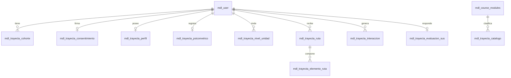

# Manual Técnico

**Plugin de perfilamiento multidimensional del estudiante y motor de recomendación de rutas de aprendizaje integrado a Moodle (local_trayecta)**

Instituto Tecnológico de Morelia, Departamento de Sistemas y Computación.  
Autores: Aguilar Garnica Alfredo, Meneses Díaz Mariana Sofía y Salvador Alejos Soria.  
Asesor: DCE. Claudio Ernesto Florián Arenas.

## Historial de revisiones

| Nombre | Fecha | Motivo del cambio | Versión |
| --- | --- | --- | --- |
| Aguilar Garnica Alfredo, Meneses Díaz Mariana Sofía | 2026-10-12 | Borrador inicial preliminar a partir del ERS v1.0 (arquitectura externa en Python/Flask con REST/LTI). | 0.1 |
| Aguilar Garnica Alfredo, Meneses Díaz Mariana Sofía, Salvador Alejos Soria | 2026-10-25 | Reescritura arquitectónica y funcional completa (alineada con ERS v1.3): migración a plugin local de Moodle (`local_trayecta`) en PHP 8.3, esquema de tablas `mdl_trayecta_*` en PostgreSQL 16 de Moodle, 4 herramientas de perfilamiento (H1 a H3 iniciales; H4 modular por unidad con reactivos del docente) y soporte para diseño cuasiexperimental (cohorte experimental vs. cohorte de control). | 1.0 |

---

## 1. Introducción

### 1.1 Propósito
Este manual describe la arquitectura interna, el modelo de datos, la lógica algorítmica del motor de recomendación, los procedimientos de despliegue y los lineamientos de mantenimiento del plugin `local_trayecta`. Complementa a la [Especificación de Requisitos de Software (ERS v1.3)](file:///c:/Users/Mariana/Desktop/Trayecta/docs/ERS.md), detallando *cómo* se implementa cada requisito dentro del ecosistema Moodle 5.1.

### 1.2 A quién va dirigido
- **Administrador del LMS:** secciones 6, 7, 8 y 11 (instalación, configuración de tareas programadas, respaldos y solución de fallas).
- **Desarrolladores del plugin:** secciones 2, 3, 4, 5, 9, 10 y 12 (arquitectura en PHP, modelo relacional, observadores de eventos, motor híbrido y pruebas PHPUnit).
- **Investigadores y asesor:** secciones 4 y 8 (algoritmo pedagógico, evaluación cuasiexperimental y extracción anonimizada de datos).

### 1.3 Documentos relacionados
- [Especificación de Requisitos de Software (ERS v1.3)](file:///c:/Users/Mariana/Desktop/Trayecta/docs/ERS.md).
- [Validación de los instrumentos que determinan el perfil (PRM-2)](file:///c:/Users/Mariana/Desktop/Trayecta/docs/SPRINT_0/PRM-2_Validación%20de%20los%20instrumentos%20que%20determinan%20el%20perfil.md).
- [Reglas para asignar etiquetas y crear rutas de aprendizaje (PRM-3)](file:///c:/Users/Mariana/Desktop/Trayecta/docs/SPRINT_0/PRM-3_Reglas%20para%20asignar%20etiquetas%20y%20crear%20ruta.md).
- [Estudio de viabilidad técnica (PRM-5)](file:///c:/Users/Mariana/Desktop/Trayecta/docs/SPRINT_0/PRM-5_estudio_viabilidad.md).
- [Flujo del proceso dentro de Moodle (PRM-6)](file:///c:/Users/Mariana/Desktop/Trayecta/docs/SPRINT_0/PRM-6_flujo_proceso.md).

---

## 2. Arquitectura del sistema

### 2.1 Visión general
El sistema Trayecta funciona **exclusivamente dentro de Moodle 5.1**, estructurado como un **plugin local (`local_trayecta`)**. No existe una aplicación externa ni servidores intermedios en Flask. Toda la lógica se ejecuta en PHP 8.3 utilizando las APIs nativas de Moodle, y el almacenamiento se realiza en tablas propias dentro de la misma base de datos PostgreSQL 16 institucional (REQ-INT-005).

| Componente | Función | Tecnología |
| --- | --- | --- |
| **Plataforma LMS** | Gestión de cursos, usuarios, calificaciones e infraestructura de grupos | Moodle 5.1, PHP 8.3 |
| **Servidor Web** | Servidor HTTP institucional con soporte SSL/TLS | Apache 2.4 / Nginx |
| **Plugin Trayecta** | Perfilamiento (H1 a H4), motor híbrido de recomendación, analíticas y gestión cuasiexperimental | PHP 8.3, Mustache, JavaScript (AMD/ES6) |
| **Base de datos** | Tablas del núcleo de Moodle y tablas del plugin (`mdl_trayecta_*`) | PostgreSQL 16 |
| **Procesamiento en segundo plano** | Tarea programada de sincronización periódica y recalculo de rutas | Moodle Scheduled Tasks API (Cron nativo) |
| **Interceptores de eventos** | Detección inmediata de recursos nuevos creados por docentes | Moodle Event Observers API |

### 2.2 Módulos internos del plugin (`local_trayecta`)

| Módulo | Responsabilidad | Requisitos |
| --- | --- | --- |
| **`classes/profiling/`** | Gestión del consentimiento informado, administración de las Herramientas 1, 2 y 3 (iniciales), y disparador de la Herramienta 4 (modular por unidad). | REQ-PER-001 a REQ-PER-011 |
| **`classes/recommender/`** | Motor híbrido (reglas pedagógicas + filtrado colaborativo), ponderaciones, resolución de arranque en frío y armado de bloques semanales. | REQ-REC-001 a REQ-REC-011 |
| **`classes/observer/`** | Observadores de eventos (`course_module_created`, `user_enrolment_created`) para ocultar recursos y perfilar estudiantes nuevos automáticamente. | REQ-INT-002, REQ-INT-007, REQ-INT-009 |
| **`classes/task/`** | Tarea programada de Moodle (`sync_task`) para auditar bitácoras, actualizar perfiles y sincronizar restricciones de grupo. | REQ-INT-003, REQ-RND-004 |
| **`classes/evaluation/`** | Registro de interacción, aplicación del cuestionario SUS al grupo experimental y cálculo de métricas comparativas cuasiexperimentales. | REQ-EVA-001 a REQ-EVA-004 |
| **`classes/privacy/`** | Cumplimiento del Privacy API de Moodle (exportación y eliminación de datos bajo normativa mexicana). | REQ-SEG-003 |

### 2.3 Flujos de ejecución y diseño cuasiexperimental

#### Flujo 1: Entrada y perfilamiento inicial
1. El estudiante inicia sesión en Moodle y entra al curso de *Fundamentos de Ingeniería de Software*.
2. El plugin verifica si pertenece al **Grupo Experimental** o al **Grupo de Control**:
   - Si pertenece al **Grupo de Control**: Visualiza todos los recursos de la materia bajo el modelo uniforme de Moodle sin restricciones de Trayecta.
   - Si pertenece al **Grupo Experimental**: Si no ha completado el perfilamiento inicial, se le restringe el acceso a los recursos didácticos (las actividades calificadas y exámenes oficiales siempre permanecen visibles y sin restricción, REQ-INT-008).
3. El estudiante experimental firma el consentimiento informado (REQ-PER-001) y completa en un solo flujo la fase inicial:
   - **H1:** *ILS de Felder-Silverman* (44 reactivos).
   - **H2:** *Preferencias de formato* (1 a 5) y *disponibilidad de tiempo* (horas y franjas).
   - **H3:** *Módulo psicométrico obligatorio* (batería oficial indicada por el docente).
4. El plugin calcula su perfil base y le asigna sus dos etiquetas iniciales de formato (REQ-REC-009).

#### Flujo 2: Diagnóstico modular por unidad temática (Herramienta 4)
1. Al inicio de una nueva unidad temática (de la 1 a la 5), el plugin habilita dentro de Moodle el examen diagnóstico correspondiente a dicha unidad.
2. El estudiante experimental responde el diagnóstico (elaborado por el docente titular con 3 reactivos por unidad).
3. El plugin evalúa el resultado y le asigna su etiqueta de nivel: `U{n}-bajo` (0-1 aciertos), `U{n}-medio` (2 aciertos) o `U{n}-alto` (3 aciertos).
4. El motor de recomendación publica y desbloquea los recursos adaptados a su nivel y estilos para esa unidad.

#### Flujo 3: Evaluación de impacto cuasiexperimental (fin de curso)
1. Ambos grupos (experimental y control) presentan los exámenes finales oficiales de la materia en idénticas condiciones.
2. Los alumnos del grupo experimental contestan la escala System Usability Scale (SUS) de 10 ítems (REQ-EVA-003).
3. El plugin genera el reporte comparativo evaluando promedio de calificaciones, desviación estándar, tasa de aprobación y nivel de interacción entre ambas cohortes (REQ-EVA-002).

---

## 3. Modelo de datos relacional (`mdl_trayecta_*`)

Las entidades residen en la base de datos PostgreSQL 16 de Moodle, definidas a través del esquema canónico `db/install.xml` de Moodle:



### 3.1 Diccionario de tablas principales

1. **`mdl_trayecta_cohorte`**: Asignación metodológica del estudiante.
   - `id` (BIGINT, PK)
   - `userid` (BIGINT, FK -> `mdl_user.id`)
   - `courseid` (BIGINT, FK -> `mdl_course.id`)
   - `tipo_cohorte` (VARCHAR(20)): `'experimental'` o `'control'`.
   - `timecreated` (BIGINT)

2. **`mdl_trayecta_perfil`**: Perfil inicial y contextual (H1 y H2).
   - `id` (BIGINT, PK)
   - `userid` (BIGINT, FK -> `mdl_user.id`)
   - `activo_reflexivo` (INT): Rango $[-11, +11]$.
   - `sensorial_intuitivo` (INT): Rango $[-11, +11]$.
   - `visual_verbal` (INT): Rango $[-11, +11]$.
   - `secuencial_global` (INT): Rango $[-11, +11]$.
   - `pref_video`, `pref_podcast`, `pref_texto`, `pref_simulacion`, `pref_ejercicio`, `pref_infografia` (NUMERIC(3,2)): Normalizado en $[0.0, 1.0]$.
   - `horas_semana` (INT): Presupuesto de estudio (2 a 20 h).
   - `franjas` (VARCHAR(100)): Franjas horarias preferidas.
   - `version` (INT), `vigente` (SMALLINT), `timemodified` (BIGINT).

3. **`mdl_trayecta_psicometrico`**: Resultados de la Herramienta 3 (obligatoria).
   - `id` (BIGINT, PK)
   - `userid` (BIGINT, FK -> `mdl_user.id`)
   - `instrumento_nombre` (VARCHAR(100)): Identificador del instrumento oficial provisto por el profesor.
   - `puntuaciones_escalas` (TEXT): JSON estructurado con los puntajes por dimensión/escala evaluada.
   - `timecreated` (BIGINT).

4. **`mdl_trayecta_nivel_unidad`**: Diagnóstico dinámico modular (Herramienta 4).
   - `id` (BIGINT, PK)
   - `userid` (BIGINT, FK -> `mdl_user.id`)
   - `unidad` (VARCHAR(50)): Identificador de la unidad temática (ej. `'unidad_1'`).
   - `puntaje` (INT): Aciertos obtenidos en el examen diagnóstico (0 a 3).
   - `nivel` (VARCHAR(10)): `'bajo'`, `'medio'` o `'alto'`.
   - `etiqueta_asignada` (VARCHAR(50)): Ej. `'U1-medio'`.
   - `timecreated` (BIGINT).

5. **`mdl_trayecta_catalogo`**: Metadatos pedagógicos de los objetos de aprendizaje.
   - `id` (BIGINT, PK)
   - `cmid` (BIGINT, FK -> `mdl_course_modules.id`)
   - `unidad` (VARCHAR(50)), `formato` (VARCHAR(20)), `nivel` (VARCHAR(10)), `duracion_min` (INT).
   - `es_obligatorio` (SMALLINT), `estado` (VARCHAR(20)): `'pendiente'`, `'publicado'`.

6. **`mdl_trayecta_ruta` y `mdl_trayecta_elemento_ruta`**: Rutas generadas por el motor híbrido para el grupo experimental.

---

## 4. Motor de recomendación híbrido

### 4.1 Entradas del motor
- Perfil del estudiante (dimensiones del ILS, formatos preferidos y presupuesto semanal de tiempo).
- Nivel de la unidad temática activa obtenido a partir de la Herramienta 4.
- Catálogo de recursos con metadatos IEEE LOM de la unidad en curso.
- Matriz de interacción colaborativa histórica acumulada en Moodle.

### 4.2 Lógica del algoritmo de recomendación

```text
Entrada: Estudiante E, UnidadActiva U, Catalogo C
1. Verificar si E pertenece a la cohorte 'experimental'. Si no, omitir (acceso estándar).
2. Obtener nivel N_U = mdl_trayecta_nivel_unidad(E, U).
3. Filtrar recursos de C donde unidad == U y nivel in (N_U, 'universal').
4. Puntuar recursos:
   Si total_interacciones < UMBRAL_ARRANQUE_FRIO:
       Puntaje(R) = Reglas_Pedagogicas(E.ILS, E.Formatos, R)
   Si no:
       Puntaje(R) = w1 * Reglas_Pedagogicas(E, R) + w2 * Filtrado_Colaborativo(E, R)
5. Ordenar recursos por: [Obligatorio DESC, Puntaje DESC, Duracion ASC].
6. Empaquetar en bloques semanales sucesivos utilizando E.horas_semana como límite de corte.
7. Asignar etiquetas de grupos de Moodle al estudiante para desbloquear su ruta en la plataforma.
```

---

## 5. Integración nativa con Moodle

### 5.1 Restricciones de disponibilidad mediante grupos
Trayecta no crea un motor de permisos paralelo; utiliza la infraestructura nativa de **Restricciones de Disponibilidad** (`core_availability`) y **Grupos** (`core_group`) de Moodle:
- Cada combinación de nivel y formato corresponde a un grupo de Moodle en el curso (ej. `U1-bajo`, `FMT-video`).
- Los objetos de aprendizaje de Moodle se configuran con una condición de disponibilidad: *"El estudiante debe pertenecer al grupo X"*.
- El plugin gestiona la membresía del estudiante en dichos grupos mediante la API `groups_add_member()` y `groups_remove_member()`.

### 5.2 Observador de eventos (`event_observer`)
Para cumplir [REQ-INT-007](file:///c:/Users/Mariana/Desktop/Trayecta/docs/ERS.md#L279) y [REQ-INT-010](file:///c:/Users/Mariana/Desktop/Trayecta/docs/ERS.md#L282), el plugin suscribe el evento `\core\event\course_module_created`:
- En cuanto el docente sube un nuevo recurso al curso, el observador lo oculta automáticamente (`visible = 0`).
- Si el docente asigna los metadatos (formato, unidad y nivel), el plugin escribe la restricción de acceso condicional y lo hace visible automáticamente.

### 5.3 Tarea programada (`scheduled_task`)
El procesamiento asíncrono se realiza con la clase `\local_trayecta	ask\sync_task`:
- Intervalo configurado: cada 5 minutos (configurable por el administrador).
- Audita el log de eventos de Moodle (`mdl_logstore_standard_log`), consolidando accesos, duración estimada y calificaciones parciales sin duplicar registros.
- Detecta altas de nuevos alumnos y bajas de matrícula (REQ-INT-009).
- Reintenta transacciones en caso de bloqueo y genera notificaciones al administrador ante fallas reiteradas (REQ-INT-006).

---

## 6. Procedimiento de instalación y despliegue

### 6.1 Requisitos del entorno institucional
- **Servidor:** Ubuntu Server 24.04 LTS (o similar).
- **Servidor Web:** Apache 2.4 con módulo `mod_rewrite` y SSL habilitado.
- **Motor PHP:** PHP 8.3 con extensiones requeridas por Moodle (`pgsql`, `mbstring`, `xml`, `curl`, `zip`, `intl`, `gd`).
- **Base de datos:** PostgreSQL 16 configurado con UTF-8.
- **Plataforma:** Moodle 5.1 instalado y funcional.

### 6.2 Pasos de instalación del plugin
1. **Descargar o clonar el código** en el directorio de plugins locales de Moodle:
   ```bash
   cd /var/www/html/moodle/local/
   git clone https://github.com/AguilaRFreddy/Trayecta.git trayecta
   ```
2. **Ajustar permisos** para el usuario del servidor web (`www-data`):
   ```bash
   chown -R www-data:www-data /var/www/html/moodle/local/trayecta
   chmod -R 755 /var/www/html/moodle/local/trayecta
   ```
3. **Ejecutar la actualización de Moodle:**
   Desde la interfaz web de Moodle como administrador (en *Notificaciones*), o mediante la interfaz de línea de comandos (CLI):
   ```bash
   sudo -u www-data php /var/www/html/moodle/admin/cli/upgrade.php --non-interactive
   ```
4. Moodle creará automáticamente todas las tablas relacionales `mdl_trayecta_*` a partir de `db/install.xml` e inicializará las tareas cron del plugin.

---

## 7. Configuración del plugin (`settings.php`)

El administrador puede configurar los parámetros del sistema desde *Administración del sitio > Extensiones > Extensiones locales > Trayecta*:
- **Cursos habilitados:** Selector de cursos donde opera el plugin.
- **Asignación de cohortes:** Porcentaje de asignación aleatoria o manual para Grupo Experimental y Grupo de Control.
- **Umbral de arranque en frío:** Número mínimo de estudiantes con perfil completo e interacciones requeridas para activar el filtrado colaborativo (por defecto: 15 perfiles / 50 interacciones).
- **Ponderaciones del motor híbrido:** Pesos asignados a reglas pedagógicas ($w_1$) y filtrado colaborativo ($w_2$).
- **Reintentos de sincronización:** Número de intentos antes de disparar alerta al administrador (por defecto: 3).

---

## 8. Pruebas y verificación automatizada

### 8.1 Pruebas con PHPUnit
El plugin incluye su suite de pruebas automatizadas en `tests/`:
- `tests/profiling_test.php`: Valida las puntuaciones del ILS (rango $[-11, +11]$), el procesamiento de la Herramienta 2 (normalización en $[0, 1]$), la persistencia del módulo psicométrico (H3) y los cortes del diagnóstico por unidad (H4).
- `tests/recommender_test.php`: Valida las reglas de asignación de etiquetas, arranque en frío y armado de bloques semanales.
- `tests/observer_test.php`: Valida que los recursos nuevos se oculten de inmediato y solo se publiquen tras recibir metadatos.

Para ejecutar las pruebas:
```bash
sudo -u www-data vendor/bin/phpunit --testsuite local_trayecta_testsuite
```

### 8.2 Validación del diseño cuasiexperimental
Al cierre del semestre, el script `classes/evaluation/quasi_experiment.php` calcula y exporta:
- Media y desviación estándar de calificaciones en exámenes finales comunes (Grupo Experimental vs. Grupo de Control).
- Prueba $t$ de Student para muestras independientes (o prueba $U$ de Mann-Whitney si los datos no presentan distribución normal).
- Puntuación media de la escala SUS en el grupo experimental.
- Reporte anonimizado para la memoria de investigación y artículo académico.
