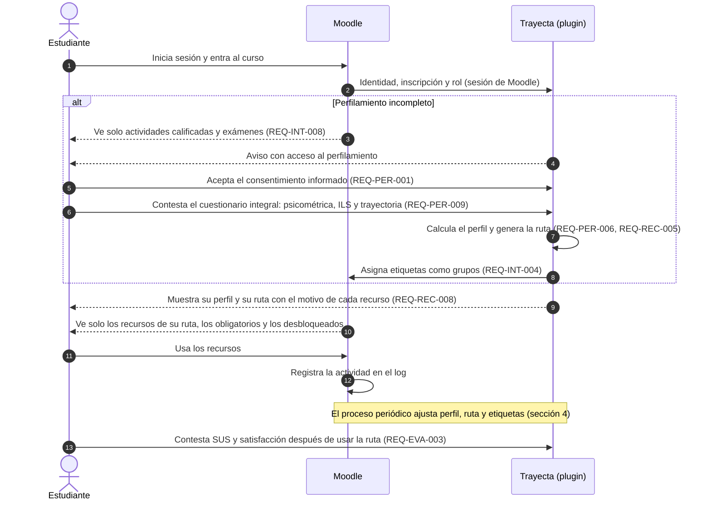
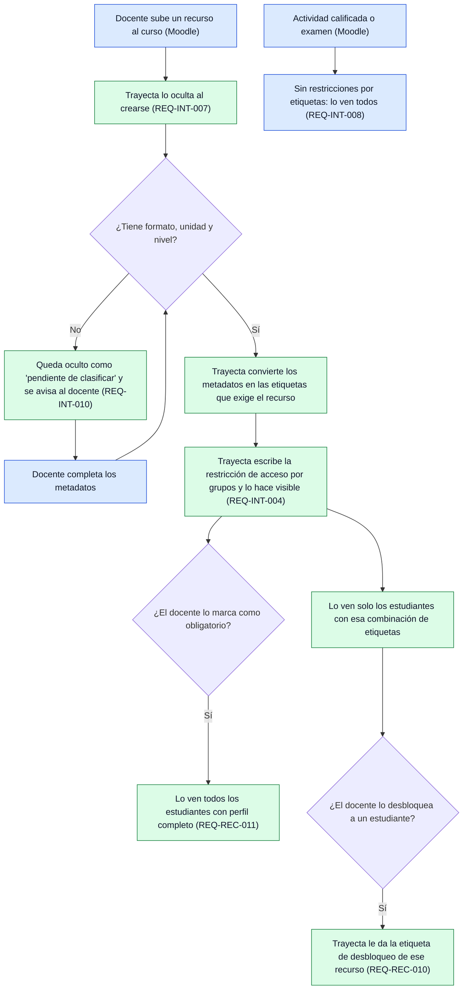
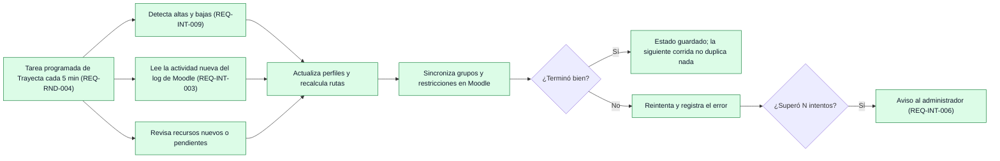

# PRM-6 · Flujo del proceso dentro de Moodle

> **Proyecto:** Aplicación web de perfilamiento multidimensional del estudiante y motor de recomendación de rutas de aprendizaje integrado a Moodle  
> **Tarea Jira:** PRM-6  
>  
> **Requisitos relacionados:** ERS 2.1.2, REQ-PER-001, REQ-PER-007, REQ-PER-009, REQ-INT-004, REQ-INT-006, REQ-INT-007, REQ-INT-008, REQ-INT-009, REQ-INT-010, REQ-REC-005, REQ-REC-010, REQ-REC-011, REQ-RND-004, REQ-EVA-003, REQ-EVA-006  
>  
> **Responsable:** Alfredo Aguilar  
>  
> **Estado:** Borrador para revisión del asesor  

**Punto de partida.** El flujo parte de las conclusiones de PRM-5. El estudiante usa su sesión de Moodle y no hace ningún registro fuera de la plataforma. Las restricciones de acceso y la lectura de actividad solo son posibles desde dentro de Moodle. Por eso se describe con la variante **plugin** recomendada en PRM-5, todavía pendiente de aprobación del asesor (ERS §2.8). En los diagramas, **Moodle** (azul) es lo que la plataforma ya hace por sí misma y **Trayecta** (verde) es lo que agrega el plugin. Lo marcado como *[Pendiente]* depende de decisiones abiertas del ERS.

## 1. Recorrido del estudiante

1. **Entrada.** El estudiante inicia sesión en Moodle y entra al curso. Trayecta lo reconoce por su sesión: no hay un segundo inicio de sesión.
2. **Sin perfil completo** (REQ-PER-007). Las restricciones por etiquetas le ocultan los recursos de estudio. Sí ve las actividades calificadas y los exámenes, que nunca se restringen (REQ-INT-008). Trayecta le muestra un aviso con acceso al perfilamiento.
3. **Consentimiento** (REQ-PER-001). Es obligatorio y va antes de todo. Si no lo acepta, no avanza ni se guarda ninguna respuesta.
4. **Cuestionario integral** (REQ-PER-009). Tiene tres partes: psicométrica, ILS de 44 ítems y trayectoria académica. La meta es completarlo en 30 minutos o menos (REQ-USA-002). *[Pendiente]* El instrumento psicométrico y los datos de trayectoria (REQ-PER-010, REQ-PER-011).
5. **Perfil, ruta y etiquetas.** Trayecta calcula el perfil y el motor genera la ruta: solo con reglas mientras no se supere el umbral de arranque en frío (REQ-REC-004). Después asigna las etiquetas de nivel por unidad y de formato como grupos de Moodle. *[Pendiente]* De dónde salen el formato y el nivel por unidad (ERS §2.8, punto 4).
6. **Su ruta.** En Trayecta ve su perfil y su ruta, con un motivo breve por recurso. En el curso de Moodle ve solo los recursos cuya combinación de etiquetas cumple, más los obligatorios y los que el docente le desbloqueó. *[Pendiente]* Si la ruta conserva los bloques semanales (ERS §2.8, punto 5).
7. **Uso.** Moodle registra cada acción en su log. El proceso periódico ajusta el perfil, la ruta y las etiquetas (REQ-PER-008, REQ-REC-006). Al acumular evidencia, pasa de dos etiquetas de formato a una (REQ-REC-009).
8. **Evaluación.** Después de usar la ruta contesta la escala SUS y el cuestionario de satisfacción (REQ-EVA-003).

## 2. Recorrido del docente: ciclo de un recurso

- **Sube y clasifica.** El docente sube el recurso como siempre en Moodle e indica su formato, unidad y nivel. Trayecta lo oculta en cuanto se crea, con un observador del evento `course_module_created`. Lo publica solo cuando tiene los tres metadatos; si falta alguno, queda pendiente y se avisa al docente. *[Pendiente]* Dónde se capturan esos metadatos: en Moodle (por ejemplo, etiquetas de actividad) o en el catálogo de Trayecta.
- **Marca obligatorios y desbloquea.** Desde Trayecta marca un recurso como obligatorio o lo desbloquea para un estudiante. El desbloqueo no cambia el perfil y sobrevive al recálculo de la ruta.
- **Consulta el panel.** Ve la distribución de perfiles de sus grupos (radar de las dimensiones del ILS), el avance de las rutas y la información completa de cada estudiante (REQ-EVA-005, REQ-EVA-006).
- **Actividades calificadas y exámenes.** Los crea y los califica como siempre en Moodle; Trayecta no los restringe.

## 3. Recorrido del administrador

1. **Instala y habilita.** Instala el plugin de Trayecta y los plugins que usa el curso, y habilita los cursos participantes (REQ-ADM-002). La instalación es estándar de Moodle y no modifica su núcleo.
2. **Configura sin tocar código:** umbrales, ponderaciones (incluido el peso del estilo de aprendizaje), texto del consentimiento y catálogo de objetos (REQ-ADM-002, REQ-ADM-003, REQ-REC-007).
3. **Gestiona roles.** Estudiante, docente y administrador, con los roles y permisos de Moodle (REQ-ADM-001).
4. **Atiende avisos** de fallas del proceso periódico (REQ-INT-006).
5. **Exporta** los datos en CSV para la investigación (REQ-EVA-004). Las publicaciones se anonimizan (REQ-SEG-003).
6. **Respalda.** Los datos de Trayecta viven en la base de datos de Moodle y entran en sus respaldos (REQ-OPER-001).

## 4. Lo que pasa por detrás

- **Proceso periódico.** Una tarea programada del plugin corre cada 5 minutos, con intervalo configurable. Hace cuatro cosas:
  - procesa altas y bajas: el estudiante nuevo queda con el perfilamiento pendiente, y al dado de baja se le quitan las etiquetas y se conservan sus datos;
  - lee la actividad nueva del log;
  - clasifica los recursos nuevos;
  - recalcula perfiles y rutas y sincroniza los grupos y las restricciones.

  Cada corrida es idempotente: repetirla no duplica registros.
- **Reacción inmediata.** El observador de `course_module_created` oculta un recurso nuevo en cuanto se crea, sin esperar a la tarea.
- **Si algo falla.** El estudiante conserva las etiquetas que ya tenía, porque son grupos guardados en Moodle. Los recursos nuevos siguen ocultos y los estudiantes nuevos no ven recursos hasta completar el perfilamiento. Trayecta reintenta, registra el error y avisa al administrador tras N intentos, con N configurable.

## 5. Comprobación del criterio de aceptación

- **Sin registro fuera de Moodle:** ningún paso pide crear una cuenta ni iniciar sesión en otro sitio. La identidad sale de la sesión de Moodle.
- **Tres roles y procesos de fondo:** secciones 1 a 4. Los diagramas distinguen lo que hace Moodle de lo que hace Trayecta.
- **Base para bocetos y pruebas funcionales.** Pantallas que salen del flujo:
  - aviso de perfilamiento;
  - consentimiento;
  - cuestionario;
  - perfil y ruta del estudiante;
  - clasificación de recursos, obligatorios y desbloqueo;
  - panel docente;
  - configuración;
  - exportación.
- **Falta:** la revisión y aprobación del asesor, y resolver los puntos *[Pendiente]* del ERS §2.8.
